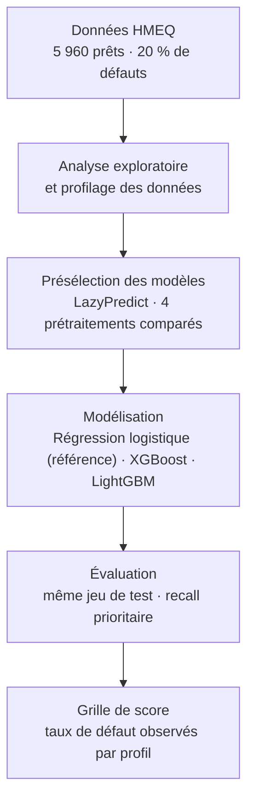

**Français** · [English](README.en.md) · [Tiếng Việt](README.vi.md)

# Scoring de risque de crédit – HMEQ

Projet de Master 2 MOSEF (Modélisations statistiques économiques et financières), réalisé en équipe, année 2024-2025.

Prédire le défaut de remboursement sur 5 960 prêts garantis par un bien immobilier, puis traduire les résultats en une grille de segmentation du risque exploitable pour la politique d'octroi.

## Résultats clés

Évaluation sur le même jeu de test (1 192 prêts, dont 265 défauts), au seuil de décision 0,5 :

| Modèle | Recall | Précision | F1 | ROC-AUC |
|---|---|---|---|---|
| Régression logistique (Lasso, variables discrétisées, class weights) | 0,69 | 0,43 | 0,53 | 0,79 |
| **XGBoost + class weights** | **0,80** | **0,89** | **0,84** | **0,96** |
| LightGBM + class weights | 0,81 | 0,85 | 0,83 | 0,96 |

- XGBoost détecte 212 défauts sur 265 sur le jeu de test, avec 27 fausses alertes sur 927 bons payeurs.
- En abaissant le seuil (point de Youden sur la courbe ROC, ≈ 0,27), le recall passe à 0,89 pour une précision de 0,77. Le choix du seuil reste une décision métier.

## Problématique

Le recall est la métrique prioritaire : un défaut non détecté coûte bien plus cher qu'un bon client refusé. La difficulté vient du déséquilibre des classes (environ 20 % de défauts) et des valeurs manquantes, notamment sur le ratio d'endettement `DEBTINC` (21 % de valeurs manquantes).

## Données

Jeu de données public **HMEQ** (Home Equity) : 5 960 prêts, 12 variables explicatives et une cible binaire `BAD` (1 = défaut, 1 189 cas).

| Variable | Description |
|---|---|
| `LOAN` | Montant du prêt demandé |
| `MORTDUE` | Montant restant dû sur l'hypothèque existante |
| `VALUE` | Valeur du bien immobilier |
| `REASON` | Motif du prêt : `DebtCon` (consolidation de dettes) ou `HomeImp` (travaux) |
| `JOB` | Catégorie professionnelle (6 modalités) |
| `YOJ` | Ancienneté dans l'emploi actuel (années) |
| `DEROG` | Nombre d'incidents graves (derogatory reports) |
| `DELINQ` | Nombre de lignes de crédit en retard de paiement |
| `CLAGE` | Ancienneté de la plus ancienne ligne de crédit (mois) |
| `NINQ` | Nombre de demandes de crédit récentes |
| `CLNO` | Nombre de lignes de crédit |
| `DEBTINC` | Ratio dette / revenu |

## Démarche

1. **Analyse exploratoire** : distributions univariées et bivariées, taux de défaut par modalité et par tranche, chevauchement des classes (pairplots). Un rapport de profilage complet est fourni (`hmeq_report.html`).
2. **Présélection des modèles** avec LazyPredict (une trentaine de classifieurs), en comparant 4 prétraitements : par défaut, suppression des outliers (IQR), prétraitement optimisé (imputation itérative, standardisation, encodage one-hot), et ce dernier combiné à SMOTE. Le recall et le ROC-AUC servent de critères, avec le temps d'exécution. `MORTDUE` est retirée car fortement corrélée à `VALUE`.
3. **Régression logistique** (modèle de référence) : vérification des hypothèses (linéarité du logit, VIF, V de Cramér), trois variantes de variables (brutes, discrétisées, combinées), régularisations Ridge, Lasso et Elastic Net, déséquilibre traité par class weights ou SMOTE.
4. **Gradient boosting (XGBoost, LightGBM)** : GridSearchCV (validation croisée stratifiée à 5 plis, optimisée sur le recall) sur les hyperparamètres et les choix de prétraitement à la fois. Comparaison sans rééquilibrage, avec SMOTE et avec class weights (`scale_pos_weight`). La version class weights est retenue : meilleur recall, sans générer de données synthétiques.
5. **Grille de score** : taux de défaut observés sur le jeu d'entraînement par profil métier × motif × incidents (`JOB` × `REASON` × `DEROG` × `DELINQ`, 203 segments), avec l'effectif de chaque segment.

## Ce que montre la grille

- Profils les moins risqués : employés de bureau (`Office`) sans incident, avec 7,8 % de défaut en consolidation de dettes et 1,2 % pour des travaux.
- Profils plus risqués : commerciaux (`Sales`, 23 % en consolidation de dettes) et indépendants (`Self`, 18 %).
- Un premier incident grave (`DEROG` = 1) augmente nettement le risque. À partir de `DEROG` ≥ 2 ou `DELINQ` > 2, les taux observés atteignent souvent 100 %, mais sur des segments de moins de 0,1 % de l'effectif.

## Limites

- La grille repose sur des **taux de défaut observés**, pas sur les scores du modèle. Les segments à très faible effectif (taux de 0 % ou 100 %) ne sont pas robustes et devraient être regroupés ou lissés avant tout usage opérationnel.
- Une seule partition train/test (80/20, non stratifiée) et pas de validation hors période : le jeu HMEQ n'a pas de dimension temporelle.
- Les résultats sont présentés au seuil 0,5 ; un seuil fondé sur une matrice de coûts réelle n'a pas été défini.
- La régression logistique et les modèles de boosting n'utilisent pas le même prétraitement : la comparaison porte sur la meilleure configuration de chaque famille.
- Le notebook a été conçu pour Google Colab (chargement depuis Google Drive) et l'environnement n'est pas figé.

## Équipe

Sara LAVAL-JEANTET, Chahla TARMOUN, Minh Nhat Thy HUYNH, Salma BENMOUSSA, sous l'encadrement de M. Ibrahim TOURE.

Contribution de Minh Nhat Thy HUYNH : présélection des modèles (LazyPredict, comparaison des prétraitements), modélisation XGBoost et LightGBM, construction des grilles de score.

## Contenu du dépôt

| Fichier | Contenu |
|---|---|
| `Scoring.ipynb` | Notebook complet : exploration, modélisation, évaluation, grilles de score |
| `Rapport_Scoring.docx` | Rapport du projet |
| `hmeq_report.html` | Rapport de profilage des données (ydata-profiling), à télécharger puis ouvrir dans un navigateur |
| `grille_de_score_weight.xlsx` | Grille de score exportée (203 segments) |
| `requirements.txt` | Bibliothèques et versions de l'environnement d'origine |

## Exécuter le notebook

1. Télécharger le jeu de données HMEQ (`hmeq.csv`), disponible publiquement, par exemple sur [Kaggle](https://www.kaggle.com/datasets/ajay1735/hmeq-data).
2. Ouvrir `Scoring.ipynb` dans Google Colab.
3. Adapter le chemin du fichier dans la cellule « Chargement des données », ou utiliser l'option d'import manuel prévue dans cette cellule.

Environnement d'origine : Google Colab, Python 3.10. Les versions des bibliothèques sont listées dans `requirements.txt`.
